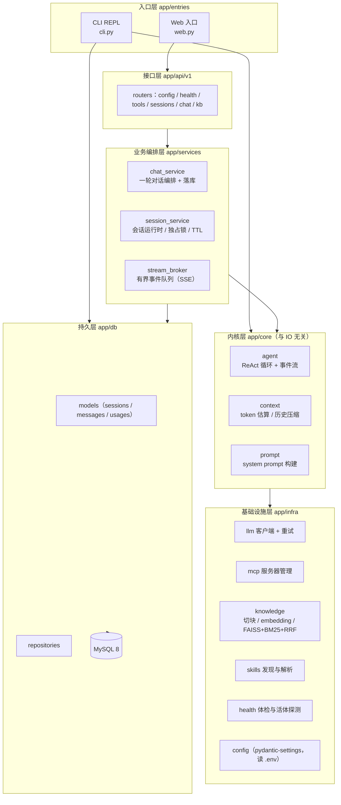
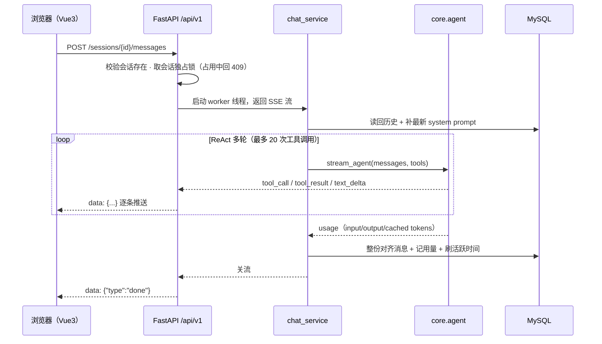

# Mini Claude

一个轻量级 AI 编码助手：**ReAct（推理 + 行动）** 内核，自带 RAG 知识库、Skills 与 MCP 扩展，
同时提供 **CLI** 与 **Web** 两个入口，两者共用同一套内核、同一份会话数据。

- 后端：Python 3.12 · FastAPI · SQLAlchemy 2 · Alembic · MySQL 8
- 前端：Vue 3 · Vite · TypeScript · Element Plus
- 部署：Docker Compose（MySQL + 后端 + Nginx）

## 架构



**分层职责**（依赖方向自上而下，内核层不依赖任何框架）：

| 层 | 职责 | 明确不做 |
|---|---|---|
| `entries/` | 装配与渲染：CLI 终端交互、Web 启动 | 不写业务逻辑 |
| `api/v1` | 路由、出入参校验、SSE 编码 | 不碰 ORM，不调 LLM |
| `services/` | 一轮对话编排、会话生命周期、事件分发、并发控制 | 不直接发 HTTP 请求 |
| `core/` | ReAct 循环、事件流、上下文压缩 | 不依赖 FastAPI / DB / 终端 |
| `infra/` | LLM、MCP、RAG、Skills、健康检查、配置 | 不感知"某次请求" |
| `db/` | ORM 模型与仓储 | 不写业务规则 |

## 项目线程



客户端断开只停止推送，worker 线程照常跑完并落库——历史不会丢。

## 目录结构

```
mini_claude/
├── backend/
│   ├── app/
│   │   ├── core/          # agent 事件流 · 上下文压缩 · system prompt
│   │   ├── infra/         # llm · mcp · knowledge(RAG) · skills · health · config · paths
│   │   ├── tools/         # specs(工具定义) · builtin(实现) · registry(分发)
│   │   ├── db/            # models · repositories · base(引擎与会话工厂)
│   │   ├── schemas/       # /api/v1 出入参
│   │   ├── services/      # chat / session / stream_broker / kb / context(AppContext)
│   │   ├── api/v1/        # system · sessions · chat · kb · router
│   │   ├── entries/       # cli.py（REPL）· web.py（uvicorn 入口）
│   │   └── main.py        # create_app() 应用装配
│   ├── alembic/           # 数据库迁移
│   ├── requirements.txt
│   └── .env.example
├── frontend/
│   ├── src/
│   │   ├── api/           # client.ts（HTTP + SSE 解析）· types.ts（契约类型）
│   │   ├── stores/chat.ts # 会话、消息流、SSE 事件处理
│   │   ├── components/    # TopBar · SessionSidebar · KbPanel · WelcomePanel
│   │   │                  # MessageList · MessageItem · ToolCard · Composer
│   │   ├── views/ChatView.vue
│   │   └── styles/main.css
│   ├── vite.config.ts     # 开发态把 /api 代理到 127.0.0.1:8000
│   └── package.json
├── deploy/                # docker-compose.yml · 两个 Dockerfile · nginx.conf
├── scripts/               # dev-backend.cmd · dev-frontend.cmd · migrate.cmd · compose-*.cmd
├── evals/                 # RAG 检索评测与工具评测（论文实验数据来源）
│                          #   eval_recall.py · compare_retrieval.py · tools_runner.py
│                          #   cases.yaml · tools_result.json · sample_skills/
└── README.md
```

## 快速开始

### 前置：配置 API Key

```cmd
copy backend\.env.example backend\.env
```

编辑 `backend\.env`，填入 `DASHSCOPE_API_KEY`。其余字段都有默认值（模型、地址、数据库连接串）。

### 方式一：Docker Compose（一键起）

```cmd
scripts\compose-up.cmd
```

浏览器打开 <http://localhost:8080>。该命令会：
构建后端镜像（装依赖）→ 构建前端产物并用 Nginx 托管 → 起 MySQL（带健康检查）→
等 MySQL 就绪后自动执行 `alembic upgrade head` → 启动后端。

停止：`scripts\compose-down.cmd`（数据留在 `mysql_data` 与 `app_data` 两个卷里）。

### 方式二：本地开发

```cmd
scripts\dev-backend.cmd     REM 后端 8000（热重载）
scripts\dev-frontend.cmd    REM 前端 5173，/api 自动代理到 8000
```

浏览器打开 <http://localhost:5173>。数据库直接复用 compose 里的那个
（它已绑定 `127.0.0.1:3306`，与本地开发共用同一份数据）：

```cmd
docker compose -f deploy/docker-compose.yml up -d mysql
scripts\migrate.cmd upgrade head
```

### 方式三：CLI

```cmd
cd backend
python -m app.entries.cli
```

CLI 与 Web 落库的是同一张 `sessions` 表，Web 侧栏能看到 CLI 的对话（带 `CLI` 标记）。

## 配置

全部配置来自 `backend/.env`（环境变量优先于文件），字段见 `backend/.env.example`：

| 变量 | 说明 | 默认 |
|---|---|---|
| `DASHSCOPE_API_KEY` | 阿里百炼 API Key（必填） | 无 |
| `MINI_CLAUDE_MODEL` | 模型名 | `qwen3.7-max` |
| `MINI_CLAUDE_BASE_URL` | OpenAI 兼容接口地址 | 阿里百炼 |
| `MINI_CLAUDE_MAX_TOKENS` | 单次生成上限 | `16384` |
| `DATABASE_URL` | SQLAlchemy 连接串（换方言只改这一行） | `mysql+pymysql://...@127.0.0.1:3306/mini_claude` |
| `MINI_CLAUDE_HOST` / `MINI_CLAUDE_PORT` | Web 监听地址 | `127.0.0.1` / `8000` |
| `MINI_CLAUDE_DATA_DIR` | 运行数据目录（skills / 索引 / mcp.json） | `~/.mini_claude` |

## REST API

接口文档：服务起来后访问 `/docs`（OpenAPI 自动生成）。全部挂在 `/api/v1` 下：

| 方法 | 路径 | 说明 |
|---|---|---|
| GET | `/config` | 当前模型配置（不回传 Key） |
| GET | `/health` | 静态体检：config/api/mcp/knowledge/tools/skills |
| GET | `/health/ping` | 活体探测：net / llm / embedding 三探针（消耗少量 token） |
| GET | `/tools` | 当前可用工具（内置 + 已连接 MCP） |
| GET | `/sessions` | 会话列表（`?source=web\|cli`、`?limit=`） |
| POST | `/sessions` | 新建会话 |
| GET | `/sessions/{id}` | 会话详情（含 user/assistant 纯文本历史） |
| PATCH | `/sessions/{id}` | 改名 |
| DELETE | `/sessions/{id}` | 删除（消息级联删除） |
| POST | `/sessions/{id}/messages` | 发消息，**SSE** 流式返回 |
| GET | `/kb/status` | 知识库索引状态 |
| POST | `/kb/rebuild` | 触发索引重建（后台执行，重复触发回 409） |

**SSE 事件契约**（`text/event-stream`，每条 `data: {json}`）：

| type | 载荷 | 含义 |
|---|---|---|
| `text_delta` | `content` | 回答的增量文本 |
| `tool_call` | `name` / `arguments` / `call_id` | 模型要调用工具 |
| `tool_result` | `name` / `call_id` / `content` | 工具执行结果 |
| `text` | `content` | 回答全文（用于最终覆盖渲染） |
| `usage` | `input_tokens` / `output_tokens` / `cached_tokens` | 本轮累计用量 |
| `compact` | `before_tokens` / `after_tokens` / `degraded` | 本轮触发了历史自动压缩 |
| `notice` | `message` | 事件过多导致部分流式文本被丢弃 |
| `error` | `kind` / `message` | 本轮失败 |
| `done` | — | 流结束 |

## 数据库

| 表 | 说明 |
|---|---|
| `sessions` | 会话：`id` · `title` · `source`(web/cli) · `model` · `created_at` · `updated_at` |
| `messages` | 消息：`session_id` · `seq` · `role` · `payload`(原始 OpenAI 消息 JSON) · `created_at` |
| `usages` | 每轮用量：`input_tokens` · `output_tokens` · `cached_tokens` · `latency_ms` |

`payload` 存原始消息（含 `tool_calls` / `tool_call_id`），回放时能原样喂给模型；
`usages` 是论文实验数据的直接来源（token 消耗、缓存命中、耗时）。

迁移命令：`scripts\migrate.cmd upgrade head`，新增迁移用
`scripts\migrate.cmd revision --autogenerate -m "说明"`。

## 功能

### ReAct 内核

标准的 `while` 循环：调用 LLM → 解析 `tool_calls` → 执行工具 → 结果回填 → 继续，最多 20 轮。
以事件流形式产出 `text_delta / tool_call / tool_result / text / usage`，CLI 与 Web 都只消费事件。

### 8 个内置工具

| 工具 | 作用 |
|---|---|
| `grep_search` | 按正则搜索文件内容行 |
| `glob_search` | 按 glob 匹配文件路径 |
| `read_file` | 读文件（带读缓存，避免重复读浪费 token） |
| `write_file` | 写文件，自动建目录 |
| `run_bash` | 执行 shell 命令（Web 端受"允许执行命令"开关控制） |
| `search_knowledge` | 语义检索本地知识库 |
| `run_skill` | 加载并执行 skill 指令 |
| `check_health` | 各模块体检，出错时定位问题模块 |

### RAG 知识库

**索引构建**：`multimodal-embedding-v1`（1024 维）→ FAISS IndexFlatL2，本地文件索引；
按段落/句切块（500 字/块，50 字重叠），动态分批 + 断点续传（中断后再次重建从断点继续）。

**检索管线**：多 query 改写 → 双通道（FAISS 稠密 + jieba/BM25 稀疏）→ RRF 融合 → Top-5。
任一环节失败都降级：改写失败只用原 query，单变体 embedding 失败丢弃该变体。

**检索效果**（2026-08-15，78 块语料，14 条黄金 query）：

| Recall@K | 多query+BM25+RRF | 单次改写+子串计数 |
|---|---|---|
| @1 | 28.6% | 7.1% |
| @3 | 57.1% | 21.4% |
| @5 | **71.4%** | 21.4% |

评测脚本在 `evals/`（黄金集 + 新旧管线对比），可直接作为论文实验章节的数据来源。

### Skills 与 MCP

- Skills：`~/.mini_claude/skills/<name>/SKILL.md`（YAML frontmatter），
  单个 description ≤ 300 字符、总量不超过上下文窗口的 1%，模型可自主调 `run_skill`。
  仓库里带一个示例：`evals/sample_skills/hanli/`（复制到 `~/.mini_claude/skills/` 即可使用）。
- MCP：支持 `stdio` 与 `streamable_http` 两种 transport，配置在 `~/.mini_claude/mcp.json`；
  启动时拉起全部服务器并合并工具表，工具名加 `{server}__{tool}` 前缀避免冲突。

### 健康检查

- `/health`（静态体检，零成本）：config / api / mcp / knowledge / tools / skills
- `/health/ping`（活体探测，消耗少量 token）：net（TCP+TLS）/ llm（最小请求）/ embedding
- 异常自动诊断：按异常类型归类疑似模块并给下一步建议，全健康时只打一行

## 设计取舍

重构时刻意处理的几件事，也是论文里可以展开的点：

1. **抽 `core` 层**：把 ReAct 循环、上下文压缩从 CLI 里剥出来，内核不再依赖终端与 HTTP，
   于是 CLI 与 Web 变成"同一内核的两个渲染器"，新增入口不需要复制业务逻辑。
2. **每会话一把独占锁**：同会话串行、跨会话并行；重复提交同一会话直接回 409，
   避免旧实现里"全局字典锁 + 消息列表被并发读写"的数据竞争。
3. **有界事件队列**：SSE 队列设上限，满了优先丢最老的 `text_delta`（最终 `text` 事件仍完整），
   客户端断开后队列不会无限堆积。
4. **会话运行时 TTL 与容量上限**：空闲自动回收、超出容量按最近最少使用淘汰，
   只回收"当前没人在跑"的会话（锁能被立刻拿到才算空闲）。
5. **失败语义**：已经流给用户看过的内容必须落库（否则刷新后历史与所见不符）；
   完全没产出时才回滚到本轮之前。历史压缩会改写整个消息列表，因此落库采用"整份对齐"而非增量追加。
6. **system prompt 不落库**：每次加载时按当前 skills 重新构建，skill 变更对老会话立即生效。

## 已知限制

- 单用户：无登录与多租户隔离（`allow_bash` 默认放开，仅在可信环境使用）
- CLI 仍是同步整段输出（Web 端才是逐 token 流式）
- MCP 仅处理 `text` 类型返回，`image`/`resource` 无法传给模型
- 工具的相对路径以 **后端进程的工作目录** 为基准（CLI 是终端当前目录，Web 是 `backend/`）
- 知识库索引需手动重建（CLI 的 `/kb rebuild` 或 `POST /api/v1/kb/rebuild`）
- Windows 下若代理软件对 API 域名做 TLS 中间人，Python 请求会报
  `SSL: CERTIFICATE_VERIFY_FAILED`：为 dashscope 域名设置 `NO_PROXY` 绕过

## 从旧版本迁移

- 旧配置文件 `~/.mini_claude/config.json` **已停用**，请把 `api_key` 迁到 `backend/.env`
  的 `DASHSCOPE_API_KEY`（其余字段有默认值，可省略）。
- 旧的单包结构（CLI 的 `python -m mini_claude.main`、Web 的 `python -m mini_claude.web`）已移除，
  改为 `python -m app.entries.cli` 与 `python -m app.entries.web`（均在 `backend/` 下）。
- 旧的 SQLite 用量文件 `~/.mini_claude/usage.db` 不再使用，用量统一记入 MySQL 的 `usages` 表。
- 若需从旧的 `usage.db` 导数：直接读 SQLite 的 `turns` 表即可（字段名与新表一致）。
